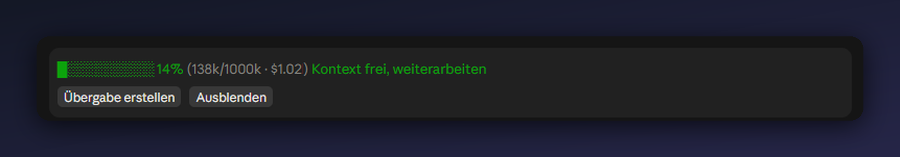

# Kontext-Wächter

*[English version](README.md)*

Eine Mod für Claude Code. Sie zeigt dir während der Arbeit, wie voll das Gedächtnis der aktuellen Session ist, und sagt dir, wann es sich lohnt, eine Zusammenfassung schreiben zu lassen und in einer frischen Session weiterzumachen. Das spart Tokens und Geld.



## Warum das hilft

Bei jeder Antwort schickt Claude das gesamte bisherige Gespräch noch einmal mit. Je länger eine Session läuft, desto mehr wird bei jeder Nachricht mitgeschleppt, und desto teurer und ungenauer wird sie. Wer rechtzeitig mit einer sauberen Zusammenfassung neu beginnt, arbeitet günstiger und bekommt bessere Antworten.

Der Kontext-Wächter nimmt dir das Beobachten ab.

## Was die Mod macht

**Füllstand im Blick.** Über dem Eingabefeld steht ein Balken mit Prozentzahl, den belegten Tokens und den bisherigen Kosten. Die Zahl wird nach jeder Antwort aktualisiert und steht auch in der Statuszeile.

**Eine Empfehlung, wann Schluss ist.**

| Füllstand | Hinweis |
|---|---|
| unter 50 % | Weiterarbeiten |
| ab 50 % | Bei einem Themenwechsel neu starten |
| ab 70 % | Zusammenfassung und neue Session lohnen sich jetzt |
| ab 85 % | Jetzt zusammenfassen und neu starten |

Beim Überschreiten von 70 % und 85 % erscheint zusätzlich ein kurzer Hinweis.

**Übergabe auf Knopfdruck.** Der Knopf „Übergabe erstellen" lässt eine Zusammenfassung für die nächste Session schreiben: Ziel, aktueller Stand, getroffene Entscheidungen, wichtige Dateien, nächste Schritte, bekannte Stolpersteine und deine Arbeitsweise. Sie wird im Projektordner unter `.claude/uebergabe/LETZTE.md` gespeichert, dazu kommt eine Kopie mit Datum im Namen.

**Neue Session automatisch (Desktop-App).** Der zweite Knopf „Übergabe + neue Session" bittet Claude zusätzlich, im selben Ordner eine frische Session zu öffnen, die die Übergabe liest und weiterarbeitet. Die Mod kann keine Session selbst öffnen, sie bittet Claude darum. Das klappt nur in der Desktop-App.

**Nahtlos weiterarbeiten.** In der neuen Session gibst du `/weiter` ein. Die Übergabe wird geladen, Claude fasst kurz zusammen, wo ihr steht, und macht beim ersten nächsten Schritt weiter. Liegt beim Start eine noch ungelesene Übergabe bereit, weist die Mod darauf hin.

**Hilfskräfte getrennt gezählt.** Subagenten haben ein eigenes Gedächtnis und füllen das der Hauptsession nicht. Sie werden deshalb nicht in den Balken eingerechnet, aber daneben mit Anzahl der Läufe und verbrauchten Tokens angezeigt.

## Befehle

| Befehl | Wirkung |
|---|---|
| `/uebergabe` | Erstellt die Übergabe, wie der Knopf |
| `/weiter` | Lädt die letzte Übergabe in die neue Session |
| `/waechter` | Blendet die Leiste ein oder aus |

## Installation

In einer Terminal-Session:

```
/plugin install kontext-waechter --marketplace KaelanTesseract/kontext-waechter
```

In der Shell:

```
claude plugin install kontext-waechter --marketplace KaelanTesseract/kontext-waechter
```

In der Desktop-App läuft `/plugin` nicht. Dort klickst du neben dem Eingabefeld auf **+**, dann auf **Plugins**, **Add marketplace** mit `KaelanTesseract/kontext-waechter` und anschließend auf **Add plugin**.

## Neue Session oder `/compact`?

`/compact` ersetzt das Gespräch in der laufenden Session durch eine Zusammenfassung, die Claude selbst auswählt. Das geht schnell, aber Details können unbemerkt verloren gehen. Eine neue Session mit Übergabe beginnt leer und bekommt nur mit, was du mitgibst. Du kannst die Übergabe vorher lesen und ändern.

Als Faustregel: Bleibst du beim selben Thema und der Füllstand liegt zwischen 50 und 70 %, reicht `/compact`. Ab 70 % oder bei einem neuen Thema ist die Übergabe die bessere Wahl.

## Anpassen

Die Schwellen (50, 70, 85 Prozent) stehen oben in `hooks/register.tsx` und lassen sich dort ändern. Dort steht auch der Text, mit dem die Übergabe angefordert wird.

## Hinweise

- Der Knopf „Übergabe erstellen" funktioniert erst, nachdem in der Session mindestens eine Antwort gelaufen ist.
- Die Übergabe-Dateien liegen im Projektordner. Wer sie nicht in Git haben möchte, trägt `.claude/uebergabe/` in die `.gitignore` ein.
- Der Dollarbetrag stammt von Claude Code selbst. Ob die Kosten der Subagenten darin enthalten sind, hängt von dessen Zählweise ab.
- Der Gesamtstand ist der Wert, den Claude Code nach der letzten Antwort meldet. Zwischen zwei Antworten ändert er sich nicht.

## Lizenz

MIT, siehe [LICENSE](LICENSE).
